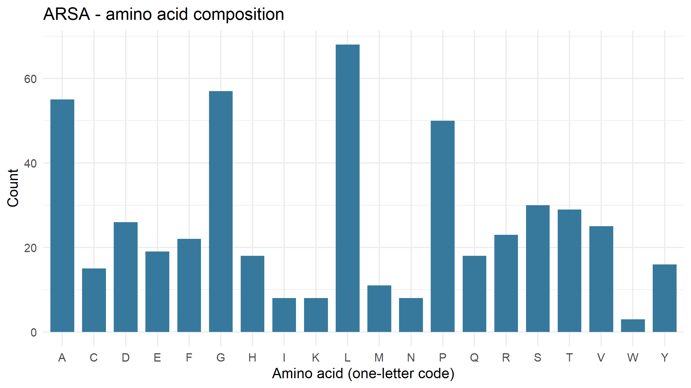
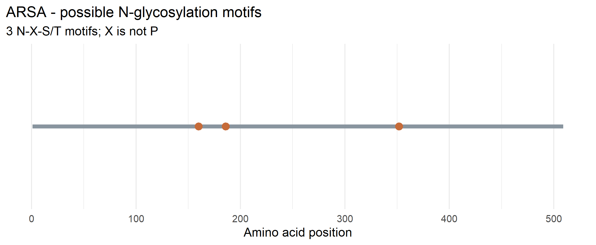

# Lysosomal Enzyme Sequence Analysis: ARSA

## 1. Introduction
This project focuses on the sequence analysis of the human lysosomal enzyme Arylsulfatase A, encoded by the ARSA gene. The objective is to examine its protein length, amino acid composition, and potential N-glycosylation motifs using NCBI and R.

## 2. Enzyme Information
- **Gene Symbol:** ARSA
- **Enzyme Name:** Arylsulfatase A
- **Protein Accession:** NP_000478.3
- **Organism:** Homo sapiens
- **NCBI Protein Record:** https://www.ncbi.nlm.nih.gov/protein/NP_000478.3

**Normal Function:**
Arylsulfatase A is a lysosomal enzyme that breaks down cerebroside-3-sulfate (sulfatides) into cerebroside and sulfate, with the help of activator protein saposin B, contributing to normal lysosomal function and lipid metabolism.

## 3. Methodology
The human ARSA protein sequence was retrieved from NCBI Protein in FASTA format using the rentrez package in R.
The protein sequence was analyzed using R to determine:
1. Total protein length.
2. Amino acid composition, counts, and percentages.
3. Potential N-glycosylation motifs (N-X-S/T), where X is not proline.
4. Positions and sequences of potential N-glycosylation motifs.
The results were summarized using CSV files, and figures were generated using the ggplot2 package.

## 4. Results
### 4.1 Protein Length and Potential N-Glycosylation Motifs
The analyzed ARSA protein sequence has a total length of 509 amino acids. A total of 3 potential N-glycosylation motifs were identified in the sequence.

| Parameter | Result |
| :--- | :--- |
| **Gene** | ARSA |
| **Protein Accession** | NP_000478.3 |
| **Protein Length** | 509 amino acids |
| **Potential N-Glycosylation Motifs** | 3 |

### 4.2 Amino Acid Composition
The amino acid composition analysis showed that leucine (L) was the most abundant amino acid, with 68 residues (13.36%). This was followed by glycine (G), with 57 residues (11.20%), alanine (A), with 55 residues (10.81%), proline (P), with 50 residues (9.82%), and serine (S), with 30 residues (5.89%).

### Figure 1. Amino Acid Composition of ARSA

*The figure illustrates the distribution of the 20 standard amino acids in the ARSA protein sequence, with leucine showing the highest count.*

### 4.3 Potential N-Glycosylation Motif Analysis
Three potential N-glycosylation motifs were detected along the ARSA protein sequence (see `results/ARSA_motif_positions.csv` for exact positions).

### Figure 2. Potential N-Glycosylation Motif in ARSA

*The figure shows the locations of the detected potential N-glycosylation motifs along the ARSA protein sequence.*

## 5. Questions and Answers
1. **What does your enzyme normally break down inside lysosomes?**
   Arylsulfatase A breaks down cerebroside-3-sulfate (sulfatides) into cerebroside and sulfate inside lysosomes, aiding in lipid degradation and normal cellular turnover.
2. **What is the total length of your protein, and which amino acids are most common?**
   The ARSA protein sequence analyzed has a total length of 509 amino acids. The most common amino acids are leucine (L, 13.36%), glycine (G, 11.20%), alanine (A, 10.81%), proline (P, 9.82%), and serine (S, 5.89%).
3. **How many potential N-glycosylation motifs did you find? Where are they located?**
   I identified 3 potential N-glycosylation motifs following the N-X-S/T pattern, where X is not proline. Their exact start positions and sequences are detailed in `results/ARSA_motif_positions.csv`.
4. **Why can glycosylation matter for lysosomal proteins? Does finding a motif prove the protein is glycosylated?**
   Glycosylation (specifically mannose-6-phosphate tagging) is critical for targeting and routing lysosomal enzymes to the lysosome, as well as protein stability. However, identifying an N-X-S/T motif only indicates a potential site and does not experimentally prove that the glycan chain is actually attached in a living cell.
5. **What could happen in the cell if your enzyme did not work properly?**
   A deficiency or malfunction in ARSA leads to Metachromatic Leukodystrophy (MLD), a severe lysosomal storage disorder characterized by the toxic accumulation of sulfatides in the nervous system, leading to progressive demyelination and neurological deterioration.

## 6. Conclusion
The sequence analysis of the human ARSA protein revealed a length of 509 amino acids, with leucine as the most abundant amino acid. Three potential N-glycosylation motifs were detected. These findings provide insight into the protein's sequence characteristics and potential glycosylation sites. However, sequence analysis alone cannot confirm actual biological glycosylation or enzyme activity.

## 7. Generated Files
- `lysosomal_enzyme_analysis.R` – R analysis script.
- `data/ARSA.fasta` – Downloaded ARSA protein sequence.
- `results/ARSA_summary.csv` – Protein length and motif summary.
- `results/ARSA_amino_acid_counts.csv` – Amino acid counts and percentages.
- `results/ARSA_motif_positions.csv` – Motif sequences and positions.
- `figures/ARSA_amino_acid_composition.png` – Amino acid composition figure.
- `figures/ARSA_potential_N_glycosylation.png` – Potential N-glycosylation motif figure.

## 8. References
1. National Center for Biotechnology Information (NCBI). ARSA protein sequence, NP_000478.3.
2. https://www.ncbi.nlm.nih.gov/protein/NP_000478.3
3. National Center for Biotechnology Information (NCBI).
4. https://www.ncbi.nlm.nih.gov/
